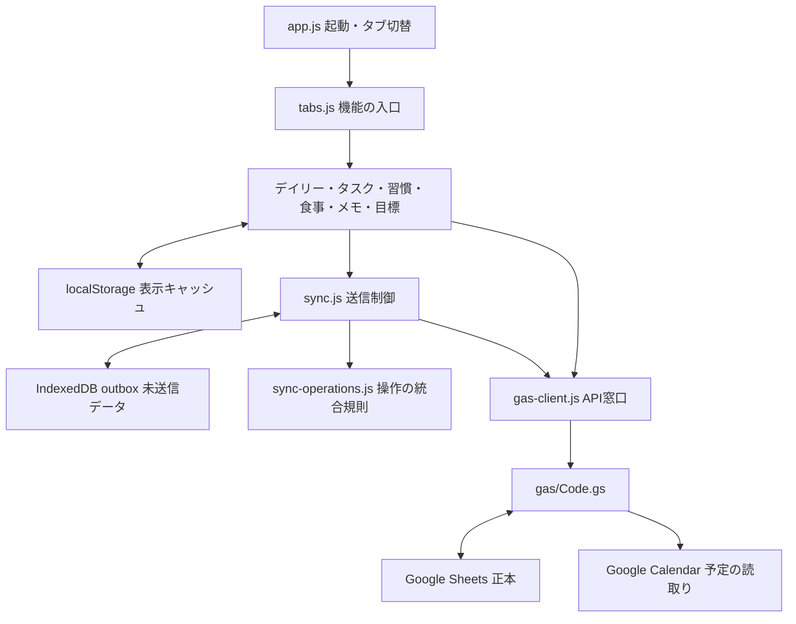

# 構成と機能追加の前提

2026-11-24、移行時 HEAD `3024521` のコードを起点に確認。現役ソースは `basabasa-hq/apps/system-techo-v3` の一箇所です。

## 全体の流れ

現状のタスク・メモには API へ直接保存し、失敗したら outbox に入れる経路もあります。今回、保存の順番やタイミングは変更していません。習慣・食事とタスクの並べ替えは outbox に先に保存します。

## 6つの画面

| 機能 | 入口 | 現在の役割 |
|---|---|---|
| デイリー | `js/daily.js` | 9カレンダーの予定、当日と期限切れのタスク。ジャーナルの取得・編集用コードも残るが、現在の画面テンプレートに追加ボタンや一覧はない |
| タスク | `js/task.js` | 状態・優先度・期限、今日の枠、状態・優先度での絞り込み、手動並べ替え、ピン留め、完了・削除 |
| 習慣 | `js/habit.js` | 日付別の整数・小数・累積・時刻・チェック、項目編集と並べ替え。グラフ・履歴は `habit-stats.js` |
| 食事 | `js/meal.js` | 月カレンダーと日別の朝・昼・夕・間食・夜食、区分ごとの時刻と本文 |
| 目標 | `js/goals.js` | 目的・目標・手段、写真付きカード、ビジョンボード。新規の専用保存領域を使用 |
| メモ | `js/memo.js` | 検索・日付別一覧、ピン留め、アーカイブ、編集・自動保存・チェック・添付・取込済表示 |

`app.js` は起動と共通イベントを担当し、`tabs.js` が描画・手動更新・必要な初回同期を登録します。タブを開くたびに別の表示先を作り、古い取得結果が別のタブを描き直さない仕組みを維持します。

目標の追加で、写真カード・目的/目標の独立一覧・コルクボードを追加した。保存モデルとAPIは [goals-feature.md](goals-feature.md) を参照。

## 保存先と互換性

| 場所 | 内容 | 維持する契約 |
|---|---|---|
| Sheets `tasks` | IDごとのタスク | 個別 upsert、`deleted` による論理削除、`sort_order` |
| Sheets `memo` | note / read_later / journal | 個別 upsert、論理削除、`pinned` / `archived` / `claude_taken` |
| Sheets `habit_days` | 日付別の値 | 変えた項目の `set` と明示的な `del` |
| Sheets `habit_items` | 項目定義 | `items` 配列の保存。項目定義の変更でも過去の日別記録は削除しない |
| Sheets `meals` | 日付別の食事区分 | 変えた区分だけの `set` |
| Sheets `メモ添付` | 添付の base64 分割保存 | 本文の `[[att:id\|name\|mime]]` トークンで参照 |
| localStorage | 表示用の控え、テーマ、並び方など | `sth_v3_*` キーと `CACHE_SCHEMA_VERSION = 4` |
| IndexedDB | 端末に残る送信待ち | DB `sth_v3`、版1、store `outbox`、既存の ID 順 |
| Cache Storage | 静的アセット、添付の控え | Service Worker の network first、添付キャッシュ `sth-att` |

`claude_taken` は `0` / 旧データの `1` / 取込日時の文字列が混在します。真偽値だけに変換しないでください。旧 outbox の習慣 `values`、食事 `slots` も読み続けます。既存キーの改名、キャッシュ版上げ、全消去、DB再作成は今回行っていません。

`config.js` の API URL・カレンダー定義と GAS 内の定義には対応関係があります。日付ユーティリティは端末のローカル日時を使い、GAS は JST で整形します。海外タイムゾーンでも常に同じ日付になる保証は現状ありません。

## 切り出した責務

| モジュール | 担当 | 依存しないもの |
|---|---|---|
| `js/tabs.js` | 各タブの描画と更新の登録 | 画面内部の状態・入力処理 |
| `js/memo/body.js` | 本文と添付トークンの分解・組立て | DOM・通信・保存 |
| `js/memo/attachments.js` | 添付の転送、画像縮小、メモリと端末の控え | メモの画面状態・本文の保存 |
| `js/sync-operations.js` | 対象キー、旧形式の解釈、変更の順序付き統合 | DOM・通信・IndexedDBへの書込み |
| `js/sync.js` | 版数・保存中の保護、永続キューへの追加、送信制御・再送 | 各画面の描画 |

`sync.mergePatch` は再 export し、既存の呼出しも維持しています。メモのキーボード制御・自前カーソル・自動保存・APIのデータ形式はそのままです。GAS と CSS の大規模な分割は今回行っていません。

## 機能を追加するとき

1. 既存画面の拡張ならその機能の入口から始め、本文変換・通信・描画を同じ関数へ詰め込まない。新タブなら描画関数と更新関数を用意し、`tabs.js` と `index.html` のボタンを登録する。
2. 保存が必要な場合は、既存の正本・API・キャッシュ・outboxとの関係を先に決める。新しいデータ形式へ変えるときは、旧データの読取りと復旧方法を含む別の変更として扱う。
3. 未送信操作が必要な新データでは、`sync-operations.js` の対象キーと統合規則、`sync.js` の送信、`gas-client.js` の窓口を対応させる。習慣・食事は全日置換をせず部分更新にする。
4. 同期取得の開始時に表示先・対象日・編集版数を固定し、入力中や古い応答で state / DOM を戻さない。`pendingKeys` は永続キューと保存処理中の両方を保護する。
5. オフライン、再読み込み、遅延応答、送信失敗中の追加入力、既存データの再保存を隔離試験で確認する。並べ替えや編集で不明な既存フィールドを落とさない。
6. 共通のソースで差分を確認する。公開前には承認と静的ファイル/SWの版更新が必要。新モジュールも配信対象に含まれることを確かめる。

## 今回の検証と残る課題

本番の GAS は呼びません。GETでもシートの作成・ヘッダ補完を行う経路があるためです。隔離した Chrome と localhost、合成APIだけで検証します。通常ブラウザの保存済みデータにも触れません。

既存試験は入力保持、タブ切替、遅延応答、オフライン再送、失敗キューの順番を確認します。追加試験では既存キャッシュと未送信操作の再読込み、旧payload、添付参照とメタデータの保持を確認します。実行手順は [tests/README.md](../tests/README.md)。

今後の候補は、メモ詳細画面のさらなる分割、タスク・メモの保存経路の統一、習慣グラフ取得時の未送信キャッシュ保護、複数端末での同時編集対策です。GAS の習慣・食事にはロックがありますが、タスク・メモに同じ保護はありません。これらは実際の要件と再現試験を用意してから変更します。

公開候補の最終確認で `build/cache-bust.sh` が現役ツリーにあることを確認し、HTML/SWの版を更新しました。共通手順として案内された `basabasa-knowledge/docs/app-git-workflow.md` の現在の所在は未確認です。公開判断には `ナレッジ_Claude-Codex共通/システム手帳_開発方針.md` の「公開前に承認を得る」「GAS反映後に画面を公開する」という既存方針を参照します。
